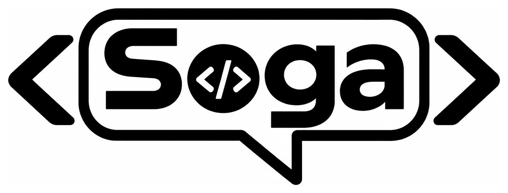

<p align="center">
  
</p>

# Soga: C++ in South African languages

**Write C++ and Arduino code in isiZulu, isiXhosa, siSwati, isiNdebele, Sesotho, Setswana, Sepedi, Xitsonga,
Tshivenḓa or Afrikaans**, with the full speed of C++. Soga translates your program into standard C++ and
builds it with a real C++ compiler, so it runs on PCs, robots and every Arduino-compatible board.

```
#faka <okokufaka_nokukhipha>

inombolo okuyinhloko() {
    jikeleza (inombolo i = 1; i <= 3; i++) {
        uma (i == 2) bhala << "Sawubona!" << umugqa;
    }
    buyisa 0;
}
```

## Features

- **Ten languages.** All 96 C++ keywords, the standard library, header names and member functions in each written official South African language. Plain English C++ also keeps working.
- **Errors as you type, in your language.** Full sentences such as `iphutha: kushoda u-';' ngaphambi kuka 'bhala'`, on the right line, with **quick fixes** (add a missing `;`, add a missing `#faka`, "did you mean").
- **A full language server:** smart completion and snippets, hover explanations (`jikeleza` → C++ `for`), go to definition, find references, rename across files, outline, parameter hints, semantic colouring, Format Document.
- **The whole Arduino starter kit:** servo, stepper, LCD1602, HC-SR04, PIR, DHT11, MPU-6050, RC522 RFID, DS3231 clock, IR remote, keypad, rotary encoder, MAX7219, 7-segment displays, buzzers, relay and L293D motors, all in your language.
- **Arduino IDE too:** install the Soga library and start a sketch with `#include <isiZulu.h>` (or your language).
- **Every Arduino-compatible board:** Uno, Nano, Mega, Leonardo, Uno R4, Nano 33 IoT/BLE, Raspberry Pi Pico, ESP32, ESP8266, STM32 and more. Click the board name in the status bar to choose a board, then **Soga: Build / upload**.
- **Libraries in your language:** ROS 2, OpenCV, Eigen, CUDA, PyTorch (libtorch), Servo, Wire, SPI and EEPROM.
- **Convert C++ into Soga.** Right-click any C++ file → **Soga: Convert C++ to Soga**.
- **South African Sign Language:** an optional sign-video dictionary for keywords, for Deaf learners. Videos are added by Deaf SASL signers.

## Getting started

1. Name your file with its language code: `robot.zu.soga` (isiZulu), `robot.xh.soga`, `.ss.soga`, `.nr.soga`, `.st.soga`, `.tn.soga`, `.nso.soga`, `.ts.soga`, `.ve.soga` or `.af.soga`.
2. Press **▶ Soga: Run** in the editor title bar, or **Soga: Show C++** to see the translation side by side.
3. For Arduino, write `setup` and `loop` in your language (`qala` and `phindaphinda` in isiZulu), pick your board in the status bar, and choose **Soga: Build / upload**.

## Requirements

- **PC programs:** a C++ compiler (`g++`). On Windows, install MinGW-w64 (for example `winget install BrechtSanders.WinLibs.POSIX.UCRT`), or use WSL.
- **Arduino:** the **Arduino IDE 2**. Soga uses the `arduino-cli` built into it, and the boards and libraries you installed there. You can also install `arduino-cli` on its own.
- **Libraries:** OpenCV, Eigen and libtorch only when you use them.

## Settings

| Setting | What it does |
|---|---|
| `soga.arduinoBoard` | Board for building, uploading and checking (`uno`, `esp32`, `pico`, `stm32-bluepill`, ... or a full board name) |
| `soga.messageLanguage` | Language of error messages (`auto` = the file's language, or `en`) |
| `soga.diagnostics.onType` | Check for errors while you type |
| `soga.inlayHints.cppNames` | Show the C++ meaning next to each word, for learners |
| `soga.compilerPath` | The C++ compiler for PC programs |

## Status

Soga is in **preview**. The word lists in every language are drafts, and native speakers and teachers are
reviewing them. Suggestions are welcome on [GitHub](https://github.com/mzwesh-1/lula/issues).

Made in South Africa.
